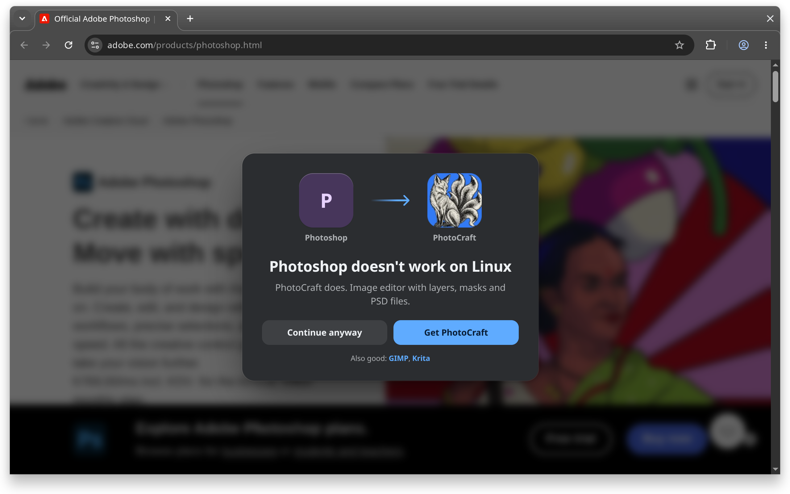

# oneBetter



oneBetter is a browser extension for Linux. When you visit the site of a Windows or macOS app, it suggests a Linux alternative.

## Install

Not in any extension store yet. Build it with [Deno](https://deno.com), then load it unpacked.

```sh
git clone https://github.com/360900/oneBetter.git
cd oneBetter
deno task build
```

**Chrome, Chromium, Brave, Edge, Vivaldi**

1. Open `chrome://extensions`.
2. Turn on Developer mode.
3. Click Load unpacked and pick `dist/chromium`.

It stays installed. After a `git pull`, rebuild and click reload on the extension.

**Firefox**

1. Open `about:debugging#/runtime/this-firefox`.
2. Click Load Temporary Add-on and pick `dist/firefox/manifest.json`.

Firefox removes it on restart. Release Firefox only keeps signed add-ons.

## Develop

```sh
deno task build   # dist/chromium and dist/firefox
deno task test
deno task check   # validate data, add --flathub --dns to verify online
```

## Data

- `data/apps/*.json`: apps, the URLs they match and their alternatives.
- `data/alternatives/*.json`: Linux apps, keyed by id.
- `data/store/*.json`: Microsoft Store product ids mapped to app ids.
- `data/icons/`: alternative icons. `deno run -A scripts/icons.ts` fetches missing ones from Flathub or `data/icons/sources.json`.

A match rule is `host` or `host/path`. Hosts include subdomains. Paths match by prefix at a segment boundary, ignoring up to two leading locale segments such as `/en-us` or `/us/en`. Store links match by product id in any of their URL forms.

```json
{
  "id": "teamviewer",
  "name": "TeamViewer",
  "match": ["teamviewer.com"],
  "linux": true,
  "alts": ["rustdesk"]
}
```

`linux` sets the wording:

- `false`: "{App} doesn't work on Linux".
- `true`: the app has a Linux build, but "{Alt} works better on oneOS".
- `"same"`: "{App} works on oneOS too", the first alternative is its Linux build. Store pages only.
- `"web"`: "{App} works in your browser", the first alternative is its web version.

Optional `why` replaces the card's description, e.g. "7-Zip for Linux is command line only."
